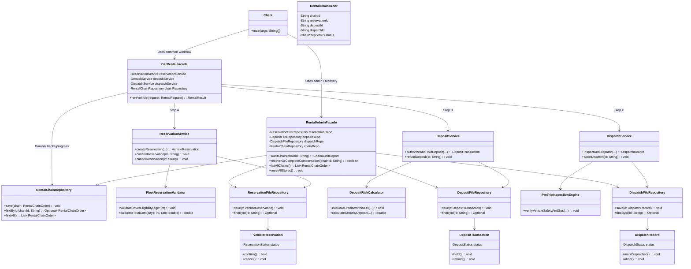

# Assignment 4: Facade Over a Three-Stage Chain with Durable Persistence & Live Demo

## Domain: Car Rental (Variant 13)
This project implements an enterprise **Car Rental Management System** built around the **Facade Pattern** (GoF) to orchestrate a durable, transactional three-stage chain across three completely independent subsystems:
- **Subsystem A (Intake & Reservation):** Manages vehicle fleet inventory, driver age verification, and initial reservation lifecycle (`VehicleReservation`).
- **Subsystem B (Financial Execution):** Assesses customer creditworthiness, computes risk-adjusted security deposits, and manages financial holds and refunds (`DepositTransaction`).
- **Subsystem C (Finalization & Dispatch):** Executes pre-trip mechanical safety diagnostics, pairs onboard GPS telematics, and authorizes key release (`DispatchRecord`).

State is durably persisted to disk files (`reservations.json`, `deposits.json`, `dispatches.json`, `rental_chains.json`), surviving unexpected process restarts and power failures. The system implements a transactional saga with two distinct compensation rollback depths.

- **GitHub Repository:** [https://github.com/Nur0550/https-github.com-Nur0550-SDP_Assignment_4](https://github.com/Nur0550/https-github.com-Nur0550-SDP_Assignment_4)

---

## 1. Subsystem Architecture & Autonomy

In strict compliance with Section 3.1:
- Each subsystem contains 5 cohesive classes (15 classes total across the three subsystems).
- Each subsystem has at least one purely business logic class, a dedicated entity enforcing legal state transitions, and its own persistence gateway.
- **No subsystem imports, calls, or has any compile-time or runtime knowledge of the other two subsystems.**

```
Subsystem A (reservation):
  ├── ReservationStatus                 (Entity State: PENDING, CONFIRMED, CANCELLED)
  ├── VehicleReservation                (Entity enforcing legal lifecycle transitions)
  ├── FleetReservationValidator         (Pure Business Logic: age >= 21, fleet check, pricing)
  ├── ReservationFileRepository         (Durable File Persistence Gateway -> data/reservations.json)
  └── ReservationService                (Autonomous Subsystem Entry Point)

Subsystem B (finance):
  ├── DepositStatus                     (Entity State: PENDING_AUTHORIZATION, HELD, REFUNDED)
  ├── DepositTransaction                (Entity enforcing legal lifecycle transitions)
  ├── DepositRiskCalculator             (Pure Business Logic: risk scoring, deposit rates)
  ├── DepositFileRepository             (Durable File Persistence Gateway -> data/deposits.json)
  └── DepositService                    (Autonomous Subsystem Entry Point)

Subsystem C (dispatch):
  ├── DispatchStatus                    (Entity State: PENDING_INSPECTION, DISPATCHED, ABORTED)
  ├── DispatchRecord                    (Entity enforcing legal lifecycle transitions)
  ├── PreTripInspectionEngine           (Pure Business Logic: brake pressure, diagnostics)
  ├── DispatchFileRepository            (Durable File Persistence Gateway -> data/dispatches.json)
  └── DispatchService                   (Autonomous Subsystem Entry Point)
```

---

## 2. UML Class Diagram



---

## 3. Principle of Least Knowledge (Law of Demeter)

The **Principle of Least Knowledge** states that a module should only communicate with its immediate "friends" and avoid navigating deeply coupled object chains across multiple unrelated subsystems.

### Concrete "Before" (Without Facade — Deep Chains, Many Friends)
Without a facade, the client is forced to instantiate, coordinate, and orchestrate all 3 subsystems manually, knowing their internal details, ordering rules, exception types, and rollback mechanisms:

```java
// === VIOLATION: Client knows too much, couples to 10+ foreign classes ===
public void clientCheckOutDirectly() {
    // Client must manage Subsystem A
    ReservationFileRepository resRepo = new ReservationFileRepository("data");
    FleetReservationValidator resVal = new FleetReservationValidator();
    ReservationService resService = new ReservationService(resRepo, resVal);
    VehicleReservation reservation = resService.createReservation("CUST-1", 25, "CAR-TESLA-303", 5, 85.0);
    resService.confirmReservation(reservation.getReservationId());

    try {
        // Client must manage Subsystem B
        DepositFileRepository depRepo = new DepositFileRepository("data");
        DepositRiskCalculator depCalc = new DepositRiskCalculator();
        DepositService depService = new DepositService(depRepo, depCalc);
        DepositTransaction deposit = depService.authorizeAndHoldDeposit(
            reservation.getReservationId(), "CUST-1", 720, 85.0, 5, false
        );

        try {
            // Client must manage Subsystem C
            DispatchFileRepository dispRepo = new DispatchFileRepository("data");
            PreTripInspectionEngine dispEngine = new PreTripInspectionEngine();
            DispatchService dispService = new DispatchService(dispRepo, dispEngine);
            DispatchRecord dispatch = dispService.inspectAndDispatch(
                reservation.getReservationId(), "CAR-TESLA-303", false
            );
            // Client must handle success...
        } catch (VehicleSafetyInspectionException e) {
            // Client forced to hand-craft 2-step rollback!
            depService.refundDeposit(deposit.getTransactionId());
            resService.cancelReservation(reservation.getReservationId());
            throw e;
        }
    } catch (DepositDeclinedException e) {
        // Client forced to hand-craft Step A rollback!
        resService.cancelReservation(reservation.getReservationId());
        throw e;
    }
}
```

### Concrete "After" (With Facade — One Immediate Friend)
With `CarRentalFacade`, the client talks to exactly **one immediate friend** through a single high-level abstraction:

```java
// === COMPLIANT: Client has exactly ONE friend, zero knowledge of internal subsystems ===
public void clientCheckOutWithFacade(CarRentalFacade rentalFacade) {
    RentalRequest request = RentalRequest.standard("CUST-1", 25, 720, "CAR-TESLA-303", 5, 85.0);
    RentalResult result = rentalFacade.rentVehicle(request);
    System.out.println("Car ready for pickup: " + result.getDispatchId());
}
```

---

## 4. Written Reflection: Facade vs. Adapter

### Architectural Distinction Based on Intent
The fundamental difference between the **Facade** and **Adapter** patterns lies in their **design intent**, rather than the number of classes they wrap.

1. **Intent of Adapter (Interface Reconciliation):**
   The Adapter pattern is a **retrospective structural wrapper**. Its purpose is to make an existing, pre-written class or third-party component fit into an **already established target interface** that the client expects. Adapter does not aim to simplify or coordinate; it translates calls 1-to-1 from one interface protocol to another so incompatible software components can collaborate.

2. **Intent of Facade (Higher-Level Orchestration & Unified Subsystem Entry):**
   The Facade pattern is a **prospective structural coordinator**. Its intent is to provide a **simplified, unified interface to a complex set of interfaces in a subsystem**. It defines a higher-level interface that makes the subsystem easier to use by orchestrating multi-stage lifecycles, enforcing execution sequence, tracking durable transaction progress, and managing multi-step compensation rollbacks.

### Application to the Car Rental Domain
In our Car Rental system:
- We did not have an existing `RentalInterface` that `ReservationService`, `DepositService`, or `DispatchService` failed to implement.
- Rather, we had three conceptually distinct domains (Fleet Reservation, Financial Banking Deposit, Telematics Safety Dispatch). The client required a single atomic business capability: *"Rent a vehicle"*.
- `CarRentalFacade` does not merely translate method names. It owns the business workflow: it verifies pre-flight eligibility, invokes Step A, durably commits Step A to disk, invokes Step B, catches financial rejection to compensate Step A, invokes Step C, and executes a real **two-step reverse rollback (B then A)** if mechanical inspection fails.
- Therefore, our system fundamentally solves a **Facade problem** (coordination, simplification, and transactional unwinding across multiple subsystems), not an Adapter problem.

---

## 5. Cross-Subsystem Consistency & Two-Step Compensation

The facade guarantees durable consistency via write-ahead chain tracking in `data/rental_chains.json`:

| Scenario | Trigger | Subsystem A Status | Subsystem B Status | Subsystem C Status | Chain Status | Rollback Depth |
| :--- | :--- | :--- | :--- | :--- | :--- | :--- |
| **Happy Path** | Valid request, credit approved, inspection clear | `CONFIRMED` | `HELD` | `DISPATCHED` | `COMPLETED` | None |
| **B Failure** | Deposit declined (credit < 580 or card rejected) | `CANCELLED` *(Compensated)* | *(None / Declined)* | *(Not reached)* | `COMPENSATED_A_ONLY` | **1-Step:** Reverses A |
| **C Failure** | Safety inspection defect (hydraulic brake loss) | `CANCELLED` *(Compensated 2nd)* | `REFUNDED` *(Compensated 1st)* | `ABORTED` / *(Failed)* | `COMPENSATED_FULL` | **2-Step:** Reverses B, then A |
| **Pre-flight** | Underage driver (age < 21) | *(None)* | *(None)* | *(None)* | `FAILED_AT_START` | None (Zero disk side-effects) |

---

## 6. How to Build, Test, and Run

### Run Unit Tests (9 Tests, 100% Passed)
```powershell
cd D:\Stady\Assignment_4_CarRental_Facade
python build_and_test.py
```
*(Tests F.I.R.S.T. compliance, domain-specific testing DSL, standalone subsystems, both compensation depths, and persistence reload crash recovery).*

### Run the Interactive Live Demo Application
```powershell
java -cp target/classes com.carrental.app.CarRentalCLI
```

### Run the Automated Defense Demonstration
```powershell
java -cp target/classes com.carrental.app.CarRentalCLI --demo
```

### Reset Data Stores to Clean State
Select option `7` in the interactive CLI, or run programmatically via `RentalAdminFacade.resetAllStores()`.
All storage files are located in `data/`.
